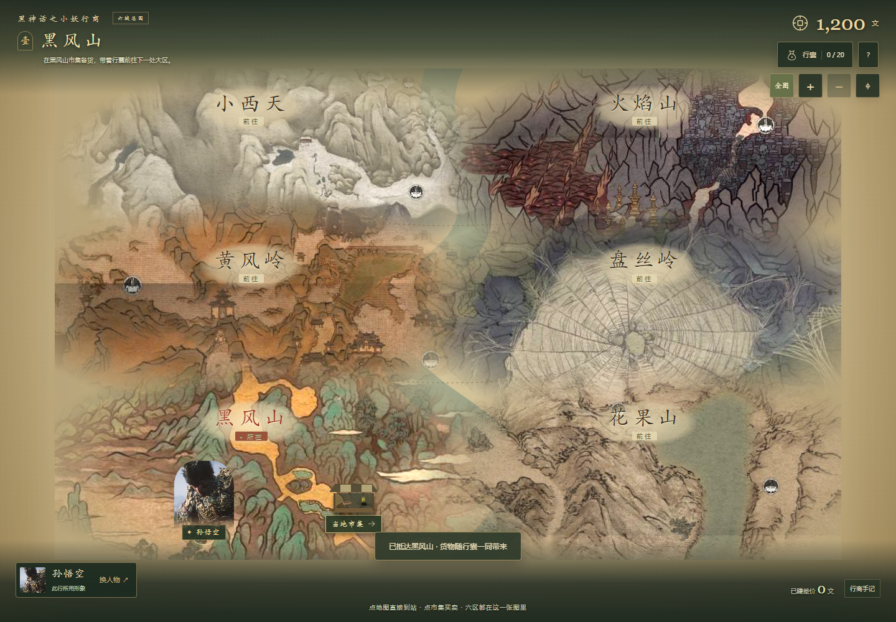

# 黑神话之小妖行商

M1-R4 可操作前端原型，2026-10-29 确认并上传。

[打开在线试玩](https://guanzigong-agent.github.io/wukong-trader/) · [查看素材来源](CREDITS.md)



## 玩法

- 一张总地图同时包含黑风山、黄风岭、小西天、盘丝岭、火焰山、花果山。
- 点击地图地形或区域名直接抵达，人物带着货物移动，总图保持不变。
- 在当地市集买入货物，换区后从行囊卖出，查看盘缠、持货和已成交差价。
- 可选择孙悟空、猪八戒、二郎神、牛魔王四个外观。
- 支持电脑鼠标与手机触屏，提供地图缩放、全图查看与按需展开的交易浮层。

## 运行

直接用浏览器打开根目录 `index.html` 即可试玩，也可通过任意静态文件服务访问。无需构建或后端。

例如在仓库根目录运行：

```shell
python -m http.server 8080 --bind 127.0.0.1
```

然后访问 `http://127.0.0.1:8080/`。

## 当前版本

本版为前端演示：固定模拟行情、初始 1,200 文、20 格行囊，刷新重置。人物直接显示原作实机半身截图；完整人物立绘、角色能力、正式经济系统和存档尚未实现。总图区位、道路和河道为本作布局提案。

上传包已通过 35 项检查，包含七种窗口尺寸、模拟触屏买卖、总图保持、钱货边界及素材哈希核对。未实测实体手机。检查记录和截图见 [docs/verification](docs/verification/)。

素材来源见 [CREDITS.md](CREDITS.md)。已获准公开仓库与试玩网页，GitHub Pages 从 main 分支根目录发布静态前端。
